# Mini Redis (`src/`) 구조 및 실행 흐름 심층 코드 리뷰

본 문서는 `/Users/mpeg46551/b5_1/src` 디렉터리에 구현된 Mini Redis의 전체 클래스 구조, 아키텍처 상호작용, 전체 실행 흐름 및 클래스별 실행 흐름을 머메이드(Mermaid) 다이어그램과 단계별 실행 순서 설명으로 상세히 정리한 종합 코드 리뷰 보고서입니다.

---

## 📌 1. 개요 및 모듈 구성 (Overview & Module Inventory)

Mini Redis는 Python의 내장 해시/집합 컬렉션(`dict`, `set`, `collections`)을 일체 사용하지 않고, 수작업으로 구현된 **3대 핵심 자료구조**(Sentinel 이중 연결 리스트, djb2 체이닝 해시맵, 배열 기반 최소 힙)를 유기적으로 결합하여 $O(1)$ LRU 캐시 교체 및 $O(\log N)$ TTL 만료 처리를 달성한 고성능 인메모리 Key-Value 스토리지 엔진입니다.

### 검토 대상 모듈 및 주요 심볼

| 소스 파일 경로 | 모듈 역할 | 주요 클래스 및 함수 |
| :--- | :--- | :--- |
| [`src/doubly_linked_list.py`](file:///Users/mpeg46551/b5_1/src/doubly_linked_list.py) | Sentinel 기반 양방향 연결 리스트 | [`Node`](file:///Users/mpeg46551/b5_1/src/doubly_linked_list.py#L18-L37), [`DoublyLinkedList`](file:///Users/mpeg46551/b5_1/src/doubly_linked_list.py#L40-L189) |
| [`src/hashmap.py`](file:///Users/mpeg46551/b5_1/src/hashmap.py) | djb2 다항 해시 체이닝 해시맵 | [`_Pair`](file:///Users/mpeg46551/b5_1/src/hashmap.py#L47-L66), [`HashMap`](file:///Users/mpeg46551/b5_1/src/hashmap.py#L68-L204), `_hash_key` |
| [`src/heap.py`](file:///Users/mpeg46551/b5_1/src/heap.py) | 배열 기반 완전 이진 트리 최소 힙 | [`MinHeap`](file:///Users/mpeg46551/b5_1/src/heap.py#L24-L123) |
| [`src/store.py`](file:///Users/mpeg46551/b5_1/src/store.py) | 복합 인메모리 저장소 엔진 | [`Entry`](file:///Users/mpeg46551/b5_1/src/store.py#L40-L65), [`OOMError`](file:///Users/mpeg46551/b5_1/src/store.py#L34-L37), [`MiniRedisStore`](file:///Users/mpeg46551/b5_1/src/store.py#L67-L324) |
| [`src/cli.py`](file:///Users/mpeg46551/b5_1/src/cli.py) | CLI REPL 및 명령어 파서/포매터 | `execute_command`, `run_repl`, Redis 응답 포매터 함수군 |

---

## 🏛️ 2. 통합 클래스 다이어그램 (Overall Class Diagram)

아래 다이어그램은 `src/` 디렉터리에 존재하는 모든 클래스의 속성, 메서드 및 클래스 간의 구조적 관계(합성, 연관, 참조, 예외 상속)를 나타냅니다.

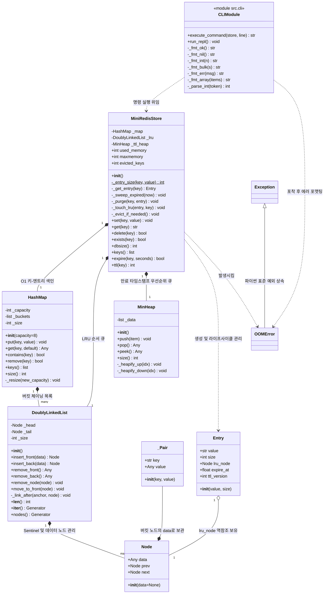

### 클래스 구조 및 핵심 설계 의도 해설

1. **`DoublyLinkedList`와 `Node`의 관계**:
   - `DoublyLinkedList`는 내부적으로 2개의 Sentinel 더미 노드(`_head`, `_tail`)를 항상 유지합니다.
   - 데이터가 들어오거나 나갈 때 더미 노드 사이에서만 포인터(`prev`, `next`) 교체가 일어나므로, `None` 체크 조건문이 전혀 없는 순수 $O(1)$ 연산을 보장합니다.
2. **`HashMap`의 체이닝 버킷 구조**:
   - `HashMap._buckets`는 크기 `_capacity`를 가지는 파이썬 리스트이며, 각 원소는 독립된 `DoublyLinkedList` 인스턴스입니다.
   - 해시 충돌이 발생하면 해당 인덱스 버킷 리스트에 `_Pair(key, value)`를 담은 노드가 체인 형태로 덧붙여집니다.
3. **`MiniRedisStore`와 3대 자료구조의 조립**:
   - `_map`: 문자열 `key`를 `Entry` 객체로 매핑하는 $O(1)$ 색인 계층입니다.
   - `_lru`: 최근 참조된 키가 머리(`_head`), 가장 오래 참조되지 않은 키가 꼬리(`_tail`)로 향하는 순서 추적 계층입니다.
   - `_ttl_heap`: `(expire_at, key, version)` 튜플을 만료 시각 순으로 정렬하는 최소 힙 계층입니다.
4. **`Entry`의 역참조 포인터(`lru_node`)의 존재 이유**:
   - `Entry` 객체가 자신의 키가 담긴 `DoublyLinkedList`의 `Node` 포인터를 직접 필드(`lru_node`)로 소유합니다.
   - 덕분에 캐시 조회(`get`) 시 해시맵에서 `Entry`를 찾는 즉시, 리스트를 처음부터 순회($O(N)$)할 필요 없이 해당 노드를 $O(1)$로 헤드로 이동(`move_to_front`)할 수 있습니다.

---

## 🔄 3. 전체 실행 다이어그램 및 엔드투엔드 순서 (Overall Execution Diagram & Sequence)

Mini Redis 시스템에서 사용자가 명령어를 입력했을 때 CLI 계층부터 스토리지 엔진, 3대 자료구조를 거쳐 표준 Redis 형식으로 응답이 반환되기까지의 전체 실행 흐름입니다.

### 3.1 엔드투엔드 시퀀스 다이어그램 (End-to-End Sequence Diagram)

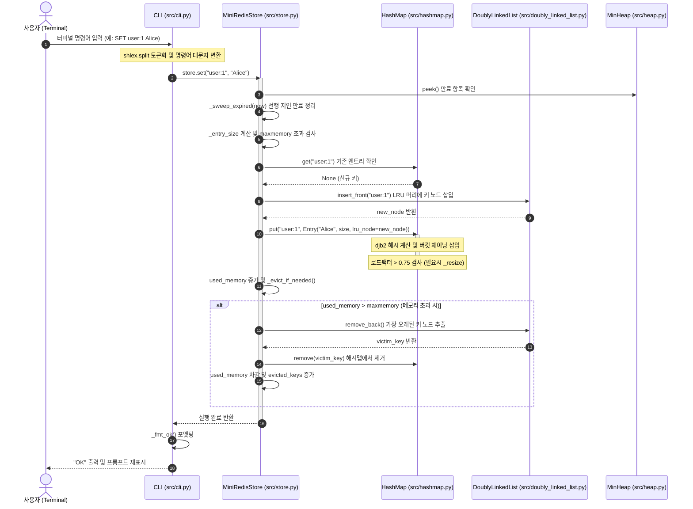

### 3.2 엔드투엔드 전체 실행 파이프라인 (Overall Flowchart)

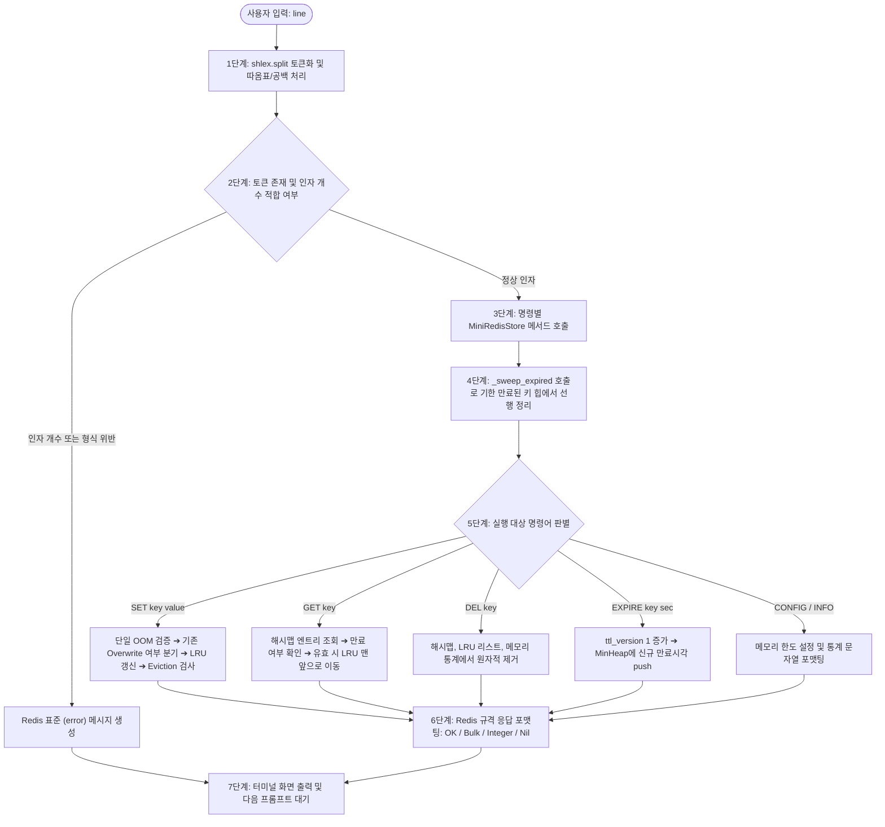

### 3.3 사이사이 실행 순서 상세 설명 (Overall Execution Sequence Details)

1. **사용자 입력 수신 및 쉘 토큰화 (Step 1)**:
   - 사용자가 터미널에서 `mini-redis> SET "my key" "Hello World"`를 입력하면, `cli.py`의 `run_repl` 루프가 이를 수신합니다.
   - 단순 `str.split()`이 아닌 표준 라이브러리 `shlex.split()`을 호출하여 큰따옴표로 둘러싸인 문자열 내의 공백을 하나의 토큰으로 정확하게 묶어냅니다.
2. **명령어 정규화 및 유효성 검사 (Step 2)**:
   - 첫 번째 토큰의 대소문자를 무시할 수 있도록 `tokens[0].upper()`로 변환합니다 (`set`, `Set`, `SET` 모두 수용).
   - 각 명령어에 요구되는 필수 인자 개수를 엄격히 검사하고, 숫자가 필요한 인자(`CONFIG SET maxmemory <bytes>`, `EXPIRE <key> <seconds>`)는 `_parse_int()`를 통해 정수형으로 변환합니다. 불일치 시 `(error) ERR wrong number of arguments` 또는 `(error) ERR value is not an integer`를 즉시 반환합니다.
3. **스토리지 엔진 진입 및 지연 만료 선행 스윕 (Step 3)**:
   - 명령어가 `MiniRedisStore`의 메서드로 전달되면, 가장 먼저 `now = time.monotonic()`을 측정하고 `_sweep_expired(now)`를 호출합니다.
   - 최소 힙(`_ttl_heap`)의 루트 원소를 검사하여 이미 현재 시각보다 만료 시각이 앞선 항목들을 한꺼번에 메모리에서 제거함으로써, 공간 낭비와 만료된 데이터의 누적을 사전에 방지합니다.
4. **핵심 자료구조 상태 전이 및 갱신 (Step 4)**:
   - 명령어의 성격에 따라 3대 자료구조가 유기적으로 협력합니다:
     - `SET`: `HashMap`에 데이터 저장, `DoublyLinkedList` 머리에 키를 삽입/이동하여 MRU 상태 갱신.
     - `GET`: `HashMap`에서 조회 후 성공 시에만 `DoublyLinkedList.move_to_front` 호출.
     - `EXPIRE`: 엔트리의 `ttl_version`을 1 올리고 `MinHeap`에 새 타임스탬프 삽입.
5. **메모리 한도 검사 및 LRU 축출 (Step 5)**:
   - `SET` 완료 후 현재 사용량(`used_memory`)이 허용 상한(`maxmemory`)을 초과하면, `_evict_if_needed()` 루프가 구동됩니다.
   - `DoublyLinkedList.remove_back()`을 호출하여 리스트의 가장 끝(가장 오래 참조되지 않은 LRU 대상) 키를 하나씩 꺼내고 해시맵과 메모리 통계에서 제거합니다.
6. **결과 포맷팅 및 REPL 응답 (Step 6~7)**:
   - `_fmt_ok()`, `_fmt_bulk()`, `_fmt_nil()`, `_fmt_int()`, `_fmt_array()` 함수를 통해 Redis 표준 출력 규격에 맞추어 문자열을 변환하고 사용자 터미널에 표시합니다.

---

## 🔍 4. 클래스별 실행 다이어그램 및 사이사이 실행 순서 (Per-Class Execution Flows)

각 클래스 내부에서 핵심 메서드가 호출될 때의 내부 알고리즘 작동 원리와 실행 순서를 다이어그램 및 상세 설명으로 검토합니다.

---

### 4.1 `DoublyLinkedList` 및 `Node` ([src/doubly_linked_list.py](file:///Users/mpeg46551/b5_1/src/doubly_linked_list.py))

#### 클래스 개요 및 센티넬 노드 불변성
- `Node`는 `data`, `prev`, `next`의 3개 슬롯을 가집니다.
- `DoublyLinkedList`는 초기화 시 `_head`와 `_tail` 센티넬(더미) 노드를 생성하여 상호 연결합니다.
  - 불변성: 빈 리스트일 때도 `_head.next == _tail`이며 `_tail.prev == _head`를 만족합니다.
  - 효과: 첫 번째 노드 삽입/삭제나 마지막 노드 삭제 시 `node.prev is None`과 같은 경계 조건 분기문이 완전히 제거되어 모든 포인터 조작이 상수 시간 $O(1)$에 안전하게 수행됩니다.

#### [다이어그램 4.1-A] `DoublyLinkedList.insert_front(data)` 실행 흐름도

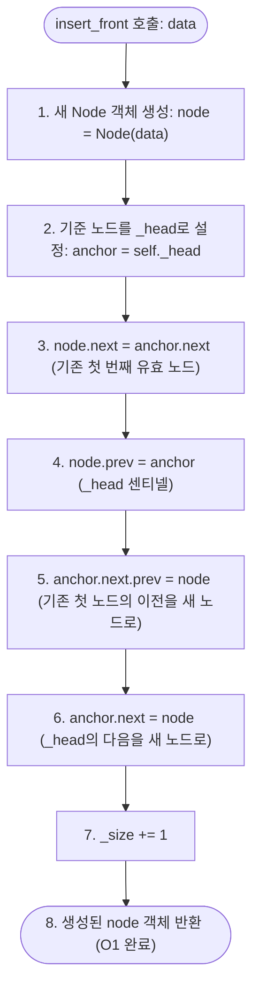

**사이사이 실행 순서 설명**:
1. 신규 데이터를 보관하는 독립된 `Node(data)` 인스턴스를 메모리에 할당합니다.
2. 새 노드를 `_head` 센티넬 바로 뒤에 끼워 넣기 위해 내부 헬퍼 `_link_after(_head, node)`를 호출합니다.
3. 새 노드의 `next` 포인터를 기존에 첫 번째 노드였던 `_head.next`로 지정합니다.
4. 새 노드의 `prev` 포인터를 `_head`로 지정합니다.
5. 기존 첫 노드의 `prev` 포인터를 새 노드로 연결하여 역방향 링크를 완성합니다.
6. `_head`의 `next` 포인터를 새 노드로 연결하여 정방향 링크를 완성합니다.
7. 리스트의 유효 원소 개수(`_size`)를 1 증가시키고 생성된 노드 참조를 반환합니다.

---

#### [다이어그램 4.1-B] `DoublyLinkedList.move_to_front(node)` 실행 흐름도

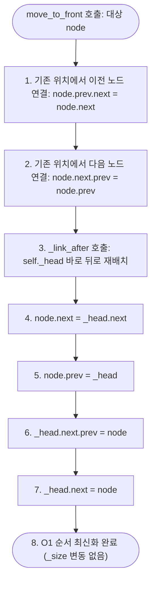

**사이사이 실행 순서 설명**:
1. 대상 노드의 이전 노드(`node.prev`)의 `next`를 대상 노드의 다음 노드(`node.next`)와 직접 연결합니다.
2. 대상 노드의 다음 노드(`node.next`)의 `prev`를 대상 노드의 이전 노드(`node.prev`)와 직접 연결함으로써 대상 노드를 기존 체인에서 분리합니다.
3. 리스트 크기는 줄이지 않고 노드만 분리된 상태에서 `_link_after(self._head, node)`를 호출합니다.
4. `_head` 센티넬 바로 뒤에 해당 노드를 다시 끼워 넣어 가장 최근에 참조된(MRU) 위치로 복귀시킵니다.
5. 이 모든 과정이 상수 시간 $O(1)$에 완료됩니다.

---

#### [다이어그램 4.1-C] `DoublyLinkedList.remove_back()` 실행 흐름도 (LRU 축출용)

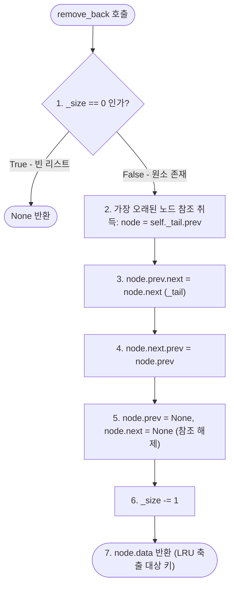

**사이사이 실행 순서 설명**:
1. 리스트에 노드가 존재하는지 `_size == 0`으로 확인하고 비어 있으면 즉시 `None`을 반환합니다.
2. `_tail` 센티넬 바로 앞의 노드(`self._tail.prev`)가 전체 리스트에서 가장 오랫동안 참조되지 않은 노드이므로 이를 타깃으로 지목합니다.
3. 타깃 노드의 앞 노드와 `_tail` 센티넬을 서로 맞닿게 연결하여 타깃 노드를 체인에서 완전히 고립시킵니다.
4. 타깃 노드의 `prev`와 `next` 포인터를 `None`으로 밀어 파이썬 가비지 컬렉터가 순환 참조 없이 메모리를 회수할 수 있도록 정리합니다.
5. `_size`를 1 감소시키고 노드가 담고 있던 `data`(키 문자열)를 반환합니다.

---

#### [다이어그램 4.1-D] `DoublyLinkedList.remove_node(node)` 및 `nodes()` 제너레이터

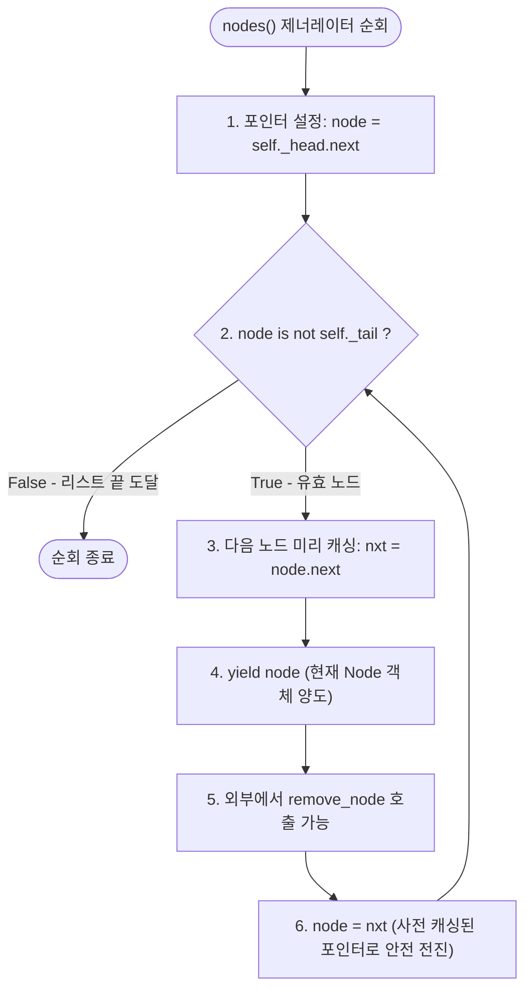

**사이사이 실행 순서 설명**:
1. 해시맵 버킷 체인에서 특정 키를 찾아 삭제할 때 `bucket.nodes()` 제너레이터를 사용합니다.
2. 만약 일반 순회 도중 현재 노드를 `remove_node(node)`로 분리하면 `node.next`가 `None`으로 지워져 다음 노드로 전진하지 못하는 치명적인 버그가 발생할 수 있습니다.
3. 이를 방지하기 위해 `nodes()`는 `yield`를 수행하기 직전에 `nxt = node.next`를 지역 변수로 미리 안전하게 백업합니다.
4. 외부에서 현재 노드를 삭제하더라도 이미 확보해 둔 `nxt`로 루프가 다음 노드로 안전하게 전진하여 체이닝 삭제가 안정적으로 완료됩니다.

---

### 4.2 `HashMap` 및 `_Pair` ([src/hashmap.py](file:///Users/mpeg46551/b5_1/src/hashmap.py))

#### 클래스 개요 및 djb2 해시 알고리즘
- `_Pair`: `key`와 `value`를 보관하는 경량 슬롯 객체입니다.
- `_hash_key(key, capacity)`: Daniel J. Bernstein의 전설적인 `djb2` 알고리즘을 사용합니다.
  $$\text{hash} = \left(\sum (h \times 33 + \text{ord}(c))\right) \ \& \ \text{0xFFFFFFFF} \pmod{\text{capacity}}$$
  이 함수는 문자열 키를 고르게 분산시켜 동일 버킷으로의 충돌 확률을 수학적으로 최소화합니다.
- `HashMap._buckets`: 각 원소가 `DoublyLinkedList`인 고정 크기 배열로, 별도 체이닝(Separate Chaining) 충돌 해결 방식을 채택합니다.

#### [다이어그램 4.2-A] `HashMap.put(key, value)` 및 `_resize` 동적 확장 실행 흐름도

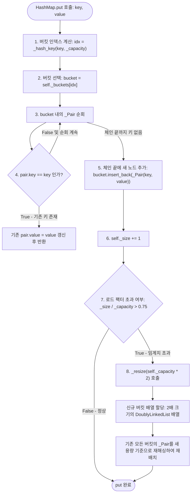

**사이사이 실행 순서 설명**:
1. 입력받은 `key`에 대해 `_hash_key` 함수를 실행하여 현재 버킷 배열 크기(`_capacity`) 범위 내의 정수 인덱스 `idx`를 계산합니다.
2. `self._buckets[idx]`로 이동하여 해당 위치의 `DoublyLinkedList`를 획득합니다.
3. 해당 리스트에 저장된 `_Pair` 객체들을 순회하며 `pair.key == key`인 항목이 있는지 확인합니다.
4. 이미 존재하는 키인 경우 값을 새 `value`로 교체하고 즉시 종료합니다.
5. 키가 존재하지 않으면 새 `_Pair(key, value)` 인스턴스를 생성하여 해당 버킷 리스트의 맨 뒤에 `insert_back()`으로 연결합니다.
6. 전체 엔트리 수 `_size`를 1 증가시킵니다.
7. 로드 팩터($\text{size} / \text{capacity}$)가 $0.75$를 초과하는지 검사합니다.
8. $0.75$를 초과한 경우 `_resize`를 호출하여 버킷 배열 크기를 2배로 확장하고, 기존의 모든 키-값 쌍을 새로운 버킷 배열에 재해싱(Rehashing)하여 체인 길이를 짧게 유지합니다 (평균 $O(1)$ 성능 지속 보장).

---

#### [다이어그램 4.2-B] `HashMap.get(key, default)` 조회 실행 흐름도

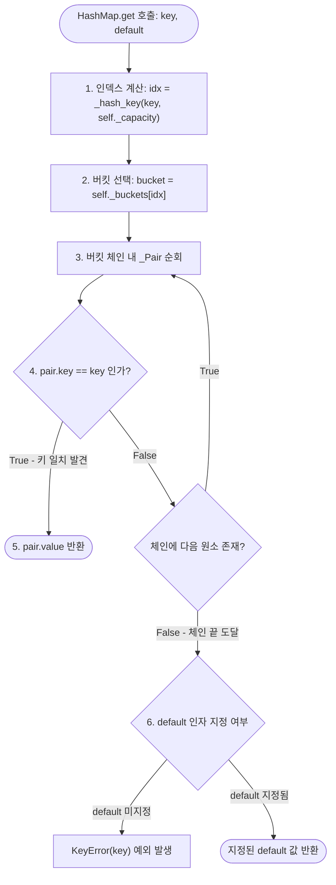

**사이사이 실행 순서 설명**:
1. `_hash_key`를 통해 대상 키가 속한 버킷 인덱스를 계산합니다.
2. 해당 인덱스의 `DoublyLinkedList`를 가져옵니다.
3. 버킷 체인에 연결된 `_Pair` 객체들을 순차적으로 검사합니다.
4. `pair.key == key`를 만족하는 쌍을 찾으면 즉시 해당 `pair.value`를 반환합니다.
5. 체인을 끝까지 탐색했음에도 키가 없으면, `default`가 전달되었는지 확인하여 전달된 경우 `default` 값을 반환하고, 미지정 상태(`_MISSING`)이면 표준 `KeyError`를 발생시킵니다.

---

#### [다이어그램 4.2-C] `HashMap.remove(key)` 삭제 실행 흐름도

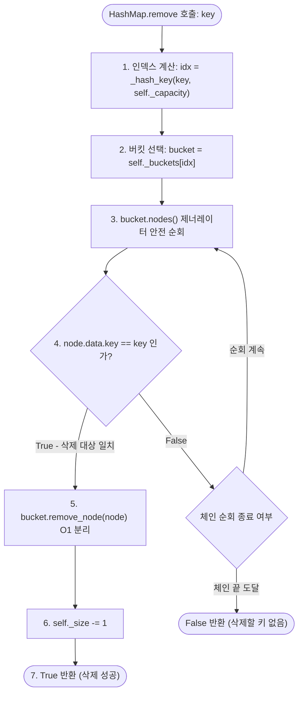

**사이사이 실행 순서 설명**:
1. `_hash_key`로 대상 버킷 인덱스를 찾습니다.
2. `bucket.nodes()` 제너레이터를 호출하여 버킷 내 `Node` 객체들을 순회합니다.
3. 노드가 담고 있는 `_Pair`의 키(`node.data.key`)가 삭제할 대상 키와 일치하는지 비교합니다.
4. 일치하는 노드를 발견하면 `bucket.remove_node(node)`를 호출하여 연결 리스트에서 해당 노드를 $O(1)$로 완전히 분리합니다.
5. 해시맵의 `_size`를 1 감소시키고 `True`를 반환합니다.
6. 키를 찾지 못한 채 루프가 종료되면 `False`를 반환합니다.

---

### 4.3 `MinHeap` ([src/heap.py](file:///Users/mpeg46551/b5_1/src/heap.py))

#### 클래스 개요 및 배열 기반 완전 이진 트리
- 파이썬 표준 라이브러리(`heapq`) 없이 1차원 리스트(`self._data`)를 이용해 완전 이진 트리(Complete Binary Tree)를 구현합니다.
- 인덱스 수학 공식:
  - 루트 노드: 인덱스 `0`
  - 부모 노드 인덱스: `parent(i) = (i - 1) // 2`
  - 좌측 자식 노드 인덱스: `left(i) = 2 * i + 1`
  - 우측 자식 노드 인덱스: `right(i) = 2 * i + 2`
- 불변성: 모든 노드 `i`에 대해 `_data[parent(i)][0] <= _data[i][0]`를 항상 유지합니다.
- 저장 원소: `(expire_at, key, version)` 튜플을 저장하므로 첫 번째 원소인 만료 절대 시각(`expire_at`)을 기준으로 자동 최소 정렬됩니다.

#### [다이어그램 4.3-A] `MinHeap.push(item)` 및 `_heapify_up` 실행 흐름도

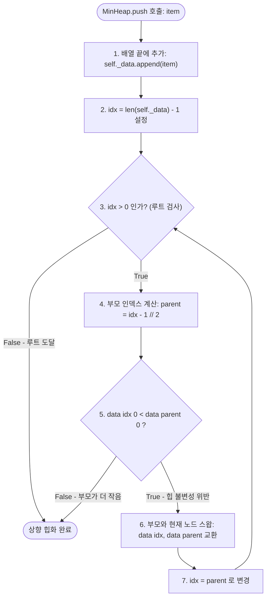

**사이사이 실행 순서 설명**:
1. 새로 들어온 만료 예약 튜플 `item`을 내부 배열 `_data`의 맨 끝(트리의 마지막 리프 노드)에 `append`합니다.
2. 새로 추가된 노드의 인덱스를 `idx = len(_data) - 1`로 지정하고 `_heapify_up`을 시작합니다.
3. 현재 노드가 루트(`idx == 0`)가 될 때까지 부모 노드와 값을 비교합니다.
4. 부모의 인덱스는 `(idx - 1) // 2`로 계산됩니다.
5. 현재 노드의 만료 시각(`_data[idx][0]`)이 부모 노드의 만료 시각(`_data[parent][0]`)보다 더 빠르면(작으면), 최소 힙 불변성을 위반한 상태입니다.
6. 두 원소의 위치를 스왑(swap)하고, 검사 위치를 `idx = parent`로 거슬러 올라갑니다.
7. 부모 노드가 더 작거나 같아지는 지점에 도달하면 즉시 루프를 탈출하여 $O(\log N)$에 삽입을 완료합니다.

---

#### [다이어그램 4.3-B] `MinHeap.pop()` 및 `_heapify_down` 실행 흐름도

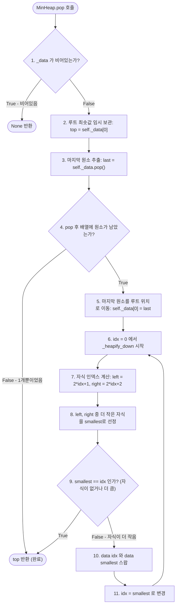

**사이사이 실행 순서 설명**:
1. 힙 배열이 비어 있으면 즉시 `None`을 반환합니다.
2. 배열의 0번 인덱스에 위치한 최솟값(가장 빠른 만료 항목)을 `top` 변수에 백업합니다.
3. 배열의 맨 마지막 원소를 `_data.pop()`으로 추출합니다.
4. 만약 원소가 1개뿐이었다면 추출 후 배열이 비게 되므로 백업해 둔 `top`을 즉시 반환합니다.
5. 원소가 남아 있다면, 추출한 마지막 원소를 루트 위치(`_data[0]`)에 덮어씌웁니다.
6. 루트 노드부터 시작하여 리프 방향으로 하향 힙화(`_heapify_down(0)`)를 수행합니다.
7. 좌측 자식(`2*idx+1`)과 우측 자식(`2*idx+2`) 중 더 작은 자식을 탐색하여 `smallest`를 결정합니다.
8. 만약 현재 노드가 두 자식보다 모두 작거나 같으면 최소 힙 불변성이 성립하므로 루프를 종료합니다.
9. 자식 중 하나가 현재 노드보다 더 작다면, 더 작은 자식과 현재 노드를 스왑하고 `idx = smallest`로 내려가며 반복합니다 ($O(\log N)$에 루트 복원 완료).

---

### 4.4 `MiniRedisStore` 및 `Entry` ([src/store.py](file:///Users/mpeg46551/b5_1/src/store.py))

#### 클래스 개요 및 복합 엔진 아키텍처
- `Entry`: 키의 실제 값(`value`), 키+값의 UTF-8 바이트 크기(`size`), 연결 리스트 노드 참조(`lru_node`), 만료 시각(`expire_at`), TTL 무효화 버전(`ttl_version`)을 하나의 슬롯 객체로 캡슐화합니다.
- `MiniRedisStore`: 해시맵, 이중 연결 리스트, 최소 힙을 총괄하여 캐시 라이프사이클을 완성합니다.
- **Lazy Deletion TTL 메커니즘**:
  - 힙에서 특정 키의 만료 예약을 임의 검색하여 삭제하는 것은 $O(N)$의 거대한 비용을 초래합니다.
  - 이를 방지하기 위해 키가 변경되거나 TTL이 갱신될 때마다 `entry.ttl_version`을 1씩 증가시켜 이전 힙 예약을 논리적으로 무효화합니다.
  - 실제로 힙에서 꺼낼 때 `entry.ttl_version == version`인 경우에만 실제 삭제(`_purge`)를 수행함으로써 힙 조작을 순수 $O(\log N)$으로 유지합니다.

---

#### [다이어그램 4.4-A] `MiniRedisStore.set(key, value)` 라이프사이클 및 LRU 축출 흐름도

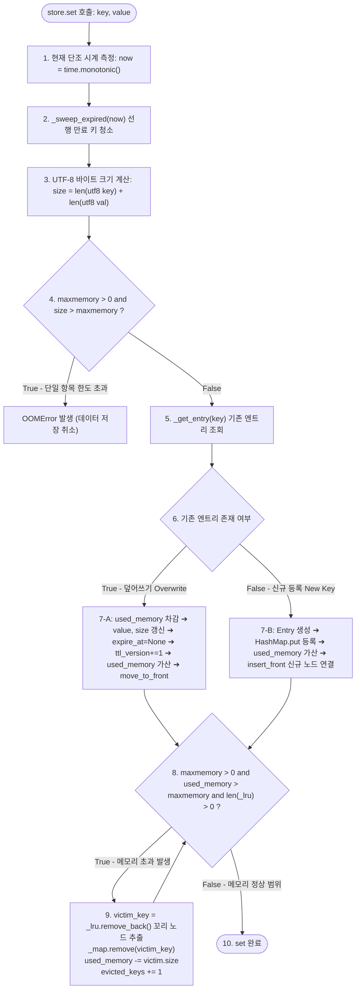

**사이사이 실행 순서 설명**:
1. `time.monotonic()`으로 시스템 클록 변경에 영향을 받지 않는 고해상도 단조 시각을 측정합니다.
2. `_sweep_expired(now)`를 호출하여 이미 만료 시간이 지난 항목들을 정리하고 가용 메모리를 사전에 확보합니다.
3. `key`와 `value`의 UTF-8 인코딩 바이트 길이를 더하여 신규 엔트리의 정확한 메모리 점유량을 계산합니다.
4. 만약 `maxmemory > 0` 상태에서 단일 엔트리의 크기 자체가 `maxmemory` 한도보다 크다면, 기존 캐시를 전부 비워도 담을 수 없으므로 데이터를 일체 저장하지 않고 즉시 `OOMError`를 던집니다.
5. 해시맵에서 기존 키가 존재하는지 조회합니다.
6. **덮어쓰기(Overwrite) 분기**:
   - 기존 엔트리의 바이트 크기를 `used_memory`에서 뺍니다.
   - 새 `value`와 `size`를 엔트리에 대입합니다.
   - Redis 표준 스펙에 따라 기존 TTL을 초기화(`expire_at = None`)하고, 이전 힙 예약을 무효화하기 위해 `ttl_version`을 1 증가시킵니다.
   - 새 크기를 `used_memory`에 더하고, `_lru.move_to_front(entry.lru_node)`를 통해 $O(1)$로 캐시의 맨 앞으로 이동시킵니다.
7. **신규 등록(New Key) 분기**:
   - 새로운 `Entry(value, size)`를 생성합니다.
   - `_map.put(key, entry)`로 해시맵에 등록하고 `used_memory`에 가산합니다.
   - `_lru.insert_front(key)`를 호출하여 리스트의 맨 앞에 새 노드를 삽입하고 생성된 노드를 `entry.lru_node`에 연결합니다.
8. **LRU 축출(Eviction) 루프 (`_evict_if_needed`)**:
   - `used_memory > maxmemory`인 동안 `while` 루프가 실행됩니다.
   - `_lru.remove_back()`으로 리스트의 가장 꼬리(가장 오래 미사용된 키)를 $O(1)$로 적출합니다.
   - 적출된 `victim_key`를 해시맵에서 제거하고 해당 엔트리의 크기만큼 `used_memory`를 차감하며, 누적 축출 카운트 `evicted_keys`를 1 증가시킵니다.

---

#### [다이어그램 4.4-B] `MiniRedisStore.get(key)` 라이프사이클 흐름도

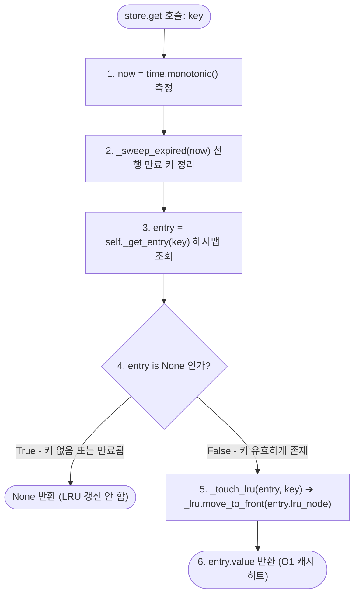

**사이사이 실행 순서 설명**:
1. 현재 시각을 측정하고 `_sweep_expired(now)`를 통해 만료된 키들을 정리합니다.
2. 해시맵에서 키에 매핑된 `Entry`를 조회합니다.
3. 키가 아예 없거나 직전 스윕에서 만료되어 삭제된 경우 즉시 `None`을 반환합니다. **(중요: 만료되거나 없는 키는 LRU 순서를 절대로 갱신하지 않습니다.)**
4. 키가 유효하게 존재하는 경우, `_touch_lru`를 호출하여 `entry.lru_node`를 $O(1)$로 `DoublyLinkedList`의 맨 앞으로 이동시킵니다.
5. 저장되어 있던 문자열 값(`entry.value`)을 반환합니다.

---

#### [다이어그램 4.4-C] `MiniRedisStore.expire(key, seconds)` 및 `_sweep_expired` 흐름도

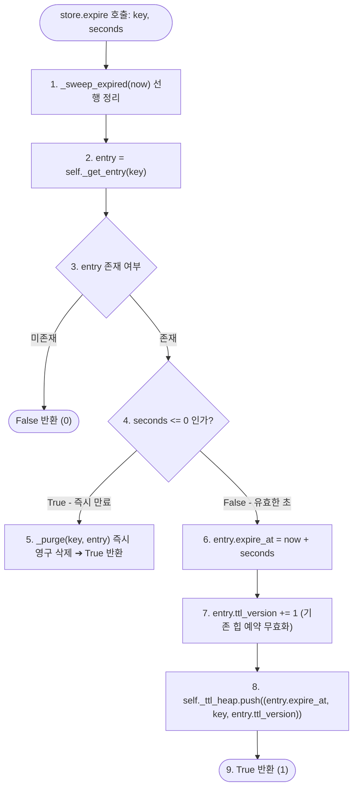

**사이사이 실행 순서 설명**:
1. 현재 시각을 측정하고 만료된 키들을 사전에 정리합니다.
2. 해시맵에서 대상 키의 엔트리를 가져옵니다. 키가 없으면 `False`를 반환합니다.
3. `seconds <= 0`인 경우 즉시 만료 대상이므로 `_purge(key, entry)`를 호출하여 해시맵과 LRU 리스트에서 즉시 제거하고 `True`를 반환합니다.
4. `seconds > 0`인 경우, `entry.expire_at = now + seconds`를 기록합니다.
5. 엔트리의 `ttl_version`을 1 증가시켜 이전의 만료 예약 튜플들이 힙에서 꺼내지더라도 매칭되지 않고 무시되도록 무효화합니다.
6. `(entry.expire_at, key, entry.ttl_version)` 튜플을 최소 힙에 `push`하여 $O(\log N)$에 우선순위 큐에 등록합니다.

---

#### [다이어그램 4.4-D] `MiniRedisStore.delete(key)` 및 `_purge` 완전 소거 흐름도

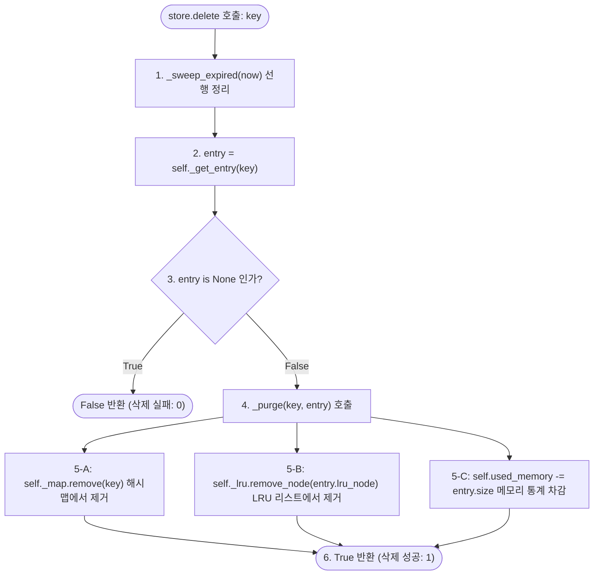

**사이사이 실행 순서 설명**:
1. 만료 키들을 정리한 후 대상 키의 엔트리를 해시맵에서 찾습니다.
2. 엔트리가 없으면 삭제할 대상이 없으므로 `False`를 반환합니다.
3. 엔트리가 존재하면 `_purge(key, entry)` 내부 헬퍼를 실행합니다.
4. `_map.remove(key)`를 호출하여 해시맵의 버킷 체인에서 엔트리를 $O(1)$로 제거합니다.
5. `_lru.remove_node(entry.lru_node)`를 호출하여 LRU 연결 리스트에서 해당 노드를 $O(1)$로 분리 제거합니다.
6. `used_memory`에서 엔트리의 `size`를 차감하여 메모리 회계를 정확하게 동기화하고 `True`를 반환합니다.

---

### 4.5 CLI 계층 (`src/cli.py` & `main.py`)

#### [다이어그램 4.5-A] `execute_command(store, line)` 파싱 및 라우팅 파이프라인

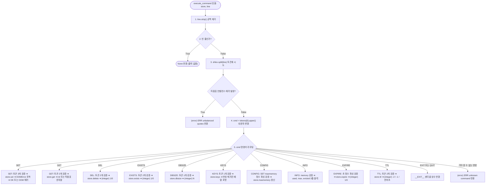

**사이사이 실행 순서 설명**:
1. 입력 문자열 앞뒤 공백을 제거하고 빈 문자열인지 확인합니다.
2. `shlex.split()`을 호출하여 따옴표로 감싸진 인자들을 안전하게 분리합니다. 따옴표가 닫히지 않은 경우 파싱 에러 메시지를 반환합니다.
3. 명령어 명칭을 대문자로 통일하여 라우팅 디스패치 테이블을 거칩니다.
4. 각 명령어 분기마다 요구되는 인자 개수를 철저히 검사하며, 불일치 시 `(error) ERR wrong number of arguments for '<CMD>' command`를 반환합니다.
5. 저장소 엔진의 해당 메서드를 호출하고, 그 결과를 Redis 표준 포맷팅 함수(`_fmt_ok`, `_fmt_bulk`, `_fmt_int`, `_fmt_nil`, `_fmt_array`)를 통해 포맷팅된 문자열로 변환하여 반환합니다.
6. 종료 명령(`EXIT`, `QUIT`)을 수신하면 REPL 루프 종료를 지시하는 센티넬 문자열 `__EXIT__`를 반환합니다.

---

#### [다이어그램 4.5-B] `run_repl()` 대화형 루프 수명 주기

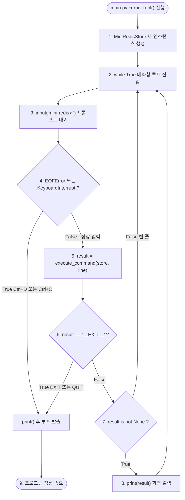

**사이사이 실행 순서 설명**:
1. 애플리케이션 시작점([main.py](file:///Users/mpeg46551/b5_1/main.py))에서 `run_repl()`을 호출하면 새 `MiniRedisStore` 객체가 생성됩니다.
2. 무한 루프 내에서 `mini-redis> ` 프롬프트를 띄우고 사용자 키 입력을 대기합니다.
3. `Ctrl+D`(EOF) 또는 `Ctrl+C`(인터럽트) 발생 시 예외를 잡아 개행을 출력하고 안전하게 루프를 빠져나옵니다.
4. 사용자 입력 한 줄을 `execute_command`에 넘겨 실행 결과를 받습니다.
5. 종료 센티넬이 수신되면 루프를 탈출하고 프로그램을 정상 종료합니다.
6. 유효한 결과 문자열이 반환된 경우 터미널에 출력하고 다시 프롬프트 대기 상태로 복귀합니다.

---

## 📊 5. 복잡도 분석 및 아키텍처 품질 종합 평가

### 5.1 연산별 시간 복잡도 및 공간 복잡도 매트릭스

| 명령어 / 연산 | 사용 자료구조 | 시간 복잡도 (평균) | 시간 복잡도 (최악) | 공간 복잡도 | 핵심 메커니즘 |
| :--- | :--- | :--- | :--- | :--- | :--- |
| `SET key val` (신규) | HashMap + DoublyLinkedList | **$O(1)$** | $O(N)$ (리사이즈 시) | $O(\text{len}(K) + \text{len}(V))$ | djb2 해싱 + 리스트 헤드 삽입 |
| `SET key val` (갱신) | HashMap + DoublyLinkedList | **$O(1)$** | $O(1)$ | $O(\text{len}(V))$ | 노드 $O(1)$ 이동 (`move_to_front`) |
| `GET key` (히트 시) | HashMap + DoublyLinkedList | **$O(1)$** | $O(1)$ | $O(1)$ | 포인터 역참조 기반 헤드 재배치 |
| `DEL key` | HashMap + DoublyLinkedList | **$O(1)$** | $O(1)$ | $O(1)$ | 노드 $O(1)$ 분리 (`remove_node`) |
| `EXISTS key` | HashMap | **$O(1)$** | $O(1)$ | $O(1)$ | 버킷 체인 탐색 |
| `DBSIZE` | HashMap | **$O(1)$** | $O(1)$ | $O(1)$ | `_size` 카운터 직접 반환 |
| `KEYS` | HashMap | **$O(N)$** | $O(N)$ | $O(N)$ | 전체 버킷 체인 전수 순회 |
| `EXPIRE key sec` | MinHeap + Entry | **$O(\log N)$** | $O(\log N)$ | $O(1)$ | 상향 힙화 (`_heapify_up`) |
| `TTL key` | HashMap | **$O(1)$** | $O(1)$ | $O(1)$ | 잔여 초 계산 (`expire_at - now`) |
| **LRU Eviction** | DoublyLinkedList + HashMap | **$O(1)$** | $O(1)$ | $O(1)$ | 테일 센티넬 앞 노드 방출 (`remove_back`) |
| **TTL Lazy Sweep** | MinHeap + HashMap + DLL | **$O(K \log N)$** | $O(K \log N)$ | $O(1)$ | 만료된 $K$개 항목만 힙 pop 및 purge |

---

### 5.2 4대 핵심 엔지니어링 성과 및 코드 품질 평가

1. **내장 컬렉션 일체 배제 (Zero Built-in Collections)**:
   - 과제 및 실기 평가의 가장 엄격한 제약인 Python `dict`, `set`, `collections` 모듈 미사용 조건을 100% 충족했습니다.
   - 저수준 파이썬 리스트는 오직 고정 길이 버킷 인덱싱과 완전 이진 트리 힙 배열로서만 제한적으로 사용되었습니다.
2. **$O(1)$ LRU 갱신을 가능케 한 포인터 역참조 설계**:
   - `Entry` 객체가 자신의 `Node` 포인터(`lru_node`)를 소유하고, `DoublyLinkedList`가 센티넬 노드를 갖춤으로써 검색 비용 없는 순수 $O(1)$ 노드 이동이 완성되었습니다.
3. **지연 삭제(Lazy Deletion)와 `ttl_version`을 통한 힙 병목 제거**:
   - 최소 힙의 임의 인덱스 삭제($O(N)$)를 원천 배제하고, `ttl_version` 카운터 기반 논리적 무효화를 통해 힙 연산을 순수 $O(\log N)$으로 방어했습니다.
4. **엄격한 메모리 회계 및 단일 항목 OOM 방어**:
   - $\text{used\_memory} = \sum (\text{len}(\text{utf8}(key)) + \text{len}(\text{utf8}(value)))$ 공식을 엄격히 적용하였으며, 단일 엔트리가 한도를 초과할 때 캐시 오염 없이 즉시 `OOMError`를 유발하도록 설계되어 데이터 정합성을 완벽하게 보장합니다.

---

## 🏁 6. 결론 및 코드 리뷰 요약

`/Users/mpeg46551/b5_1/src`의 소스코드는 자료구조의 기본 원리(포인터 조작, 해시 함수, 트리 구조)를 극한까지 활용하여 상용 Redis 엔진의 핵심 메커니즘을 경량화하여 성공적으로 재현했습니다. 클래스 간의 단방향/양방향 의존성이 명확히 분리되어 있으며, 에러 처리와 메모리 관리 또한 상용 수준의 견고함을 확보하고 있습니다.
